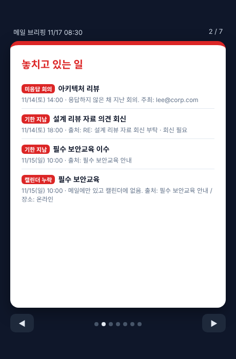

# mailbrief

Windows Outlook의 메일과 캘린더를 읽고, 사내 LLM(OpenAI 호환 API)으로 다음을 정리하는 에이전트입니다.

1. **데일리 메일 요약** — 최근 24시간 메일을 우선순위·분류별로 요약
2. **놓치고 있는 일** — 응답 없이 지난 회의, 기한이 지난 할 일, 캘린더에 없는 지난 일정, 회신 지연
3. **다가오는 일정** — 캘린더 일정, 메일 속 마감, 캘린더에 없는 메일 속 일정, 응답이 필요한 초대

결과는 **카드 팝업**(◀ ▶ 로 넘기는 카드 뉴스)으로 보여 줍니다. 전체 리포트는 HTML/Markdown 파일로 저장합니다.

<p align="center"></p>

## 동작 방식

| 모드 | 언제 | 하는 일 |
|---|---|---|
| **메일 도착 시** (`watch`) | Outlook `NewMailEx` 이벤트 → 수 초 내. 그리고 5분마다 폴링(절전 후 누락분 보충) | 새 메일이 속한 스레드를 분류·요약·할 일 추출, 스토리 갱신. 중요 메일, 24시간 내 마감, 회의 초대면 알림 카드 팝업 |
| **정해진 시각** (`watch` 의 `brief_times`) | 기본 08:30 | 전체 브리핑을 만들고 카드 팝업 |
| **수동 실행** (`run`) | 사용자가 실행 | 전체 브리핑 1회 |

- **읽음/안 읽음과 관계없이 처리합니다.** Outlook에서 이미 읽은 메일도 분류, 요약, 놓친 일 판정에 포함됩니다.
- 같은 대화(RE:, FW:, 회신:)는 스레드 1개로 묶어 **LLM을 1번만** 호출합니다. 새 회신이 오면 그 스레드만 다시 분석합니다(SQLite 캐시). 알림은 메일당 1번만 띄웁니다.
- 받은편지함과 보낸편지함을 같이 읽습니다. 내 회신이 마지막이면 "회신 지연"이 아닙니다. 같은 메일의 사본(Message-ID)은 1통으로 셉니다.

## 설치 (Windows)

준비: Windows 10/11, Outlook(Classic) 데스크톱, Python 3.11 이상(python.org 설치본, tcl/tk 포함), Git.

```powershell
git clone https://github.com/seungbinshin/mailbrief.git
cd mailbrief
powershell -ExecutionPolicy Bypass -File scripts\install.ps1            # 사내 프록시: -Proxy http://proxy:8080
notepad config.toml                                                     # [llm] base_url, model / [source] my_address
.venv\Scripts\mailbrief check-llm                                        # 사내 LLM 연결 확인
.venv\Scripts\mailbrief run                                              # 첫 브리핑 + 카드 팝업
powershell -ExecutionPolicy Bypass -File scripts\register_task.ps1      # 로그온 시 자동 시작(watch)
```

업데이트:
```powershell
powershell -ExecutionPolicy Bypass -File scripts\update.ps1   # git pull + 재설치 + 작업 재시작. config.toml 유지
```

자동 시작 해제: `scripts\register_task.ps1 -Unregister`

## 명령

| 명령 | 설명 |
|---|---|
| `mailbrief run` | 전체 브리핑. `out/` 에 파일 저장 후 카드 팝업 (`--no-popup`, `--no-llm`, `--no-deliver`) |
| `mailbrief watch` | 상주 실행. 새 메일 처리 + `brief_times` 브리핑 (`--once`, `--no-popup`) |
| `mailbrief popup` | 마지막 브리핑 카드를 다시 띄움 |
| `mailbrief diagnose` | 분류 실패 원인 분석 (`--sample 30`, `--retry`) |
| `mailbrief done KEY` | 할 일 완료 처리. 리포트의 `done KEY` 값 사용 |
| `mailbrief check-llm` | LLM 엔드포인트 테스트 |
| `mailbrief story` | 검토 대기와 진행 중 스토리 목록. `show S3`, `promote R2 --owner X --end "..."`, `promote R2 --into S3`, `dismiss R2`, `set S3 ...`, `confirm`, `close`, `reopen`, `merge S4 S3`, `unlink`, `new` |
| `mailbrief dashboard` | 스토리 대시보드(`out/stories.html`)와 스토리 폴더를 다시 생성 |
| `mailbrief eval export` / `eval score FILE` | 실제 메일로 스토리 판정 정확도 측정(CSV에 정답 입력 → 정밀도·포착률) |
| `mailbrief check-source` | 메일 수집 경로 점검: 메일 수, conversation_id 비율, 사본, 스레드 수, 예상 LLM 호출 수 |

카드 팝업 조작: ← → 키, ◀ ▶ 버튼, 마우스 휠, Esc 닫기, "전체 보기"는 HTML 리포트를 엽니다.
카드 페이지(`out/latest_cards.html`)는 브라우저에서도 같은 방식으로 넘길 수 있습니다.

## 분류 기준과 실패 점검

분류 기준은 `config.toml` 의 `[analysis.categories]` 에서 바꿉니다. 코드를 바꿀 필요가 없습니다.
일부 메일 분류가 실패하면 **[docs/CLASSIFICATION_GUIDE.md](docs/CLASSIFICATION_GUIDE.md)** 의 절차를 따릅니다.

```powershell
.venv\Scripts\mailbrief diagnose              # 실패 코드별 건수 + 점검 항목
.venv\Scripts\mailbrief diagnose --sample 30  # 최근 30건 즉시 분류: 성공률, 분포, 경고
.venv\Scripts\mailbrief diagnose --retry      # 실패 메일 재실행, out\debug\ 에 프롬프트·원문 출력 저장
```

실패해도 브리핑은 중단되지 않습니다. 실패한 메일은 규칙 기반으로 분류되고, 다음 실행에서 다시 LLM으로 시도합니다.

## 설계

```
[Outlook COM | EWS | Graph] 받은편지함 + 보낸편지함
        │  사본 제거(Message-ID) → 스레드 묶기(conversation_id, 없으면 제목+참여자)
        │  전처리(HTML→텍스트, 인용·서명 제거, 길이 제한)
        │                           │
        │                사내 LLM: 스레드 1개 → JSON (요약, 분류, 우선순위, 할 일+기한, 일정, 회의 종류,
        │                                             스토리 사실: 지속성·담당·종결 조건·확신도·매칭 후보)
        │                실패 → 짧은 본문으로 재시도 → 규칙 기반 대체 + 실패 코드 기록 (스토리 판정 보류)
        │                           │
        └─ 캘린더 ─────→  규칙 엔진(결정적 판정)  ←── SQLite: 캐시, 실패 기록, 완료 처리, 알림 기록, 스토리
                          · 놓침/다가옴           ·  스토리 판정: story / review(검토 대기) / none
                                    │
                         사내 LLM: 3줄 브리핑 (실패 시 규칙 문장)
                                    │
     카드 팝업(tkinter) · 카드 HTML · 전체 리포트(HTML/MD) · 스토리 대시보드 · 스토리 폴더 · 본인 메일 발송(선택)
```

- LLM은 스레드에서 **사실만** 추출합니다. "놓침/다가옴"과 "스토리 여부" 판정은 규칙 엔진이 합니다. 결과를 예측하고 테스트할 수 있습니다.
- Windows 기본 소스는 Outlook COM입니다. 앱 등록과 비밀번호가 필요 없습니다. 실행 중인 Outlook 프로필의 메일함을 읽습니다.

### 판정 규칙

| 구분 | 조건 |
|---|---|
| 미응답 회의 (놓침) | 내가 주최자 아님, 응답 요청됨, 응답 없음, 시작 시각이 지남 |
| 응답 필요 초대 | 위와 같으나 시작 시각이 앞으로 7일 이내 |
| 기한 지난 할 일 | 메일에서 추출한 내 할 일, 기한 < 현재, `done` 처리 안 됨 (회신 필요 메일이면 "회신 필요" 표시를 합침) |
| 캘린더 누락 일정 | 메일 속 일정이 캘린더에 없음(시각 ±30분, 제목 유사도). 지난 것은 놓침, 앞으로는 다가옴 |
| 회신 지연 | 스레드의 마지막 메일이 회신을 요구, 마지막 메일이 내 메일이 아님, 내가 To 수신자, 48시간 경과 |
| Outlook 플래그 | 플래그 기한을 내 할 일로 추가 |

## 다른 메일 소스

| 환경 | `source.type` | 설치 |
|---|---|---|
| Outlook Classic (Windows) | `com` (기본) | 기본 포함(pywin32) |
| 온프레미스 Exchange, EWS 허용 | `ews` | `pip install -e ".[ews]"` |
| Microsoft 365, Entra 앱 등록 가능 | `graph` | `pip install -e ".[graph]"` |

> New Outlook(웹 기반)은 COM을 지원하지 않습니다. Classic Outlook을 쓰거나 `ews`/`graph` 를 씁니다.

## 개발

```bash
pip install -e ".[dev]" && python -m pytest -q
```
테스트는 가짜 메일(브리핑 8건, 스토리 시나리오 14건), 일정 6건, 가짜 LLM, 로컬 HTTP 목업 서버로 실행합니다. Outlook과 사내 LLM이 없어도 실행됩니다.
스토리 시나리오는 사내 실측 문제(매칭 실패 → 스토리 승격, 뉴스레터·알림의 스토리화, 공지 속 업무 누락, 같은 날 초안 삭제, 리뷰 상태 고착, 폴더명 슬래시, RE: 중복)를 재현합니다.

## 참고한 오픈소스

| 프로젝트 | 참고한 부분 |
|---|---|
| [exchangelib](https://github.com/ecederstrand/exchangelib) | EWS 소스 |
| [msal](https://github.com/AzureAD/microsoft-authentication-library-for-python) + Microsoft Graph | Graph 소스(device code 인증) |
| [outlook-mcp-server](https://github.com/marlonluo2018/outlook-mcp-server), [mailslide](https://github.com/linax777/mailslide) | Outlook Classic COM 자동화 |
| [inbox-ai](https://github.com/LiteObject/inbox-ai) | JSON 추출 + LLM 실패 시 규칙 기반 대체 |
| [inbox-zero](https://github.com/elie222/inbox-zero) | 분류 규칙 아이디어 |

## 다음 단계

1. 사내 Outlook 에서 `mailbrief check-source` 로 수집 경로 확정 ([STORY_TRACKING.md](docs/STORY_TRACKING.md) 8.1절)
2. 실제 메일 2주분으로 `mailbrief eval export` → 정답 입력 → `eval score` (8.2절). 목표: 스토리 정밀도 ≥ 90%, 포착률 ≥ 95%
3. 기존 Story-tracker 폴더 정리 후 `story new` 로 실제 스토리만 다시 등록 (7절)
4. Teams/사내 메신저 알림 채널

## License

MIT
